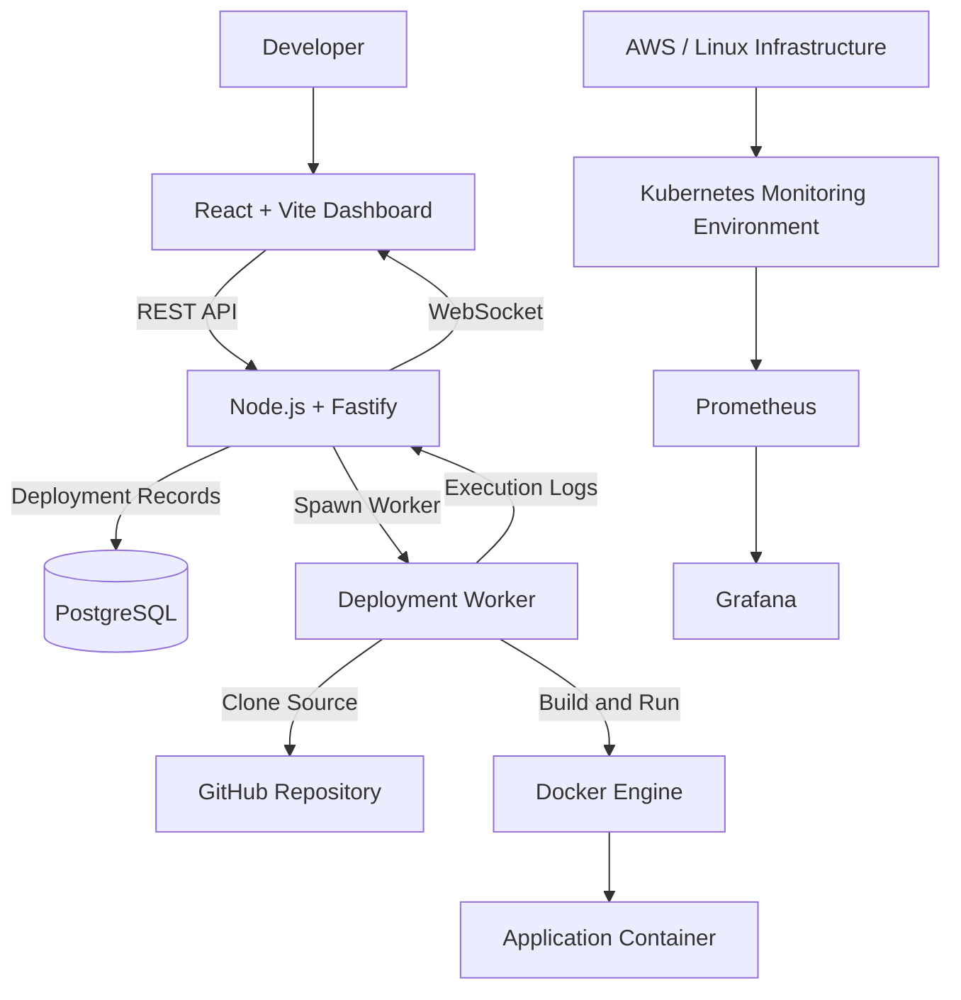
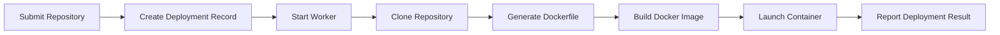

# DeployMesh
### Cloud-Native Application Deployment & Automation Platform

**Deploy applications from GitHub repositories through a unified, full-stack deployment workflow.**

DeployMesh is a full-stack DevOps automation platform that connects source-code management, backend job execution, Docker containerization, cloud infrastructure, and operational monitoring.

The project explores how deployment platforms can transform source repositories into running containerized applications while reducing repetitive manual operations.

**Core Technologies:** React · Vite · Node.js · Fastify · PostgreSQL · WebSocket · Docker · Kubernetes · AWS · Terraform · Ansible · Prometheus · Grafana

---

## Overview

Traditional application deployment involves manually cloning repositories, installing dependencies, configuring environments, building container images, and managing running services.

DeployMesh introduces a centralized workflow where developers submit a GitHub repository URL through a web dashboard.

The platform coordinates the deployment process using a backend API and a separate worker that performs Git and Docker operations.

Deployment status, execution logs, and supporting infrastructure metrics help developers understand the outcome of each deployment.

### Engineering Focus

- Full-stack application architecture
- REST API development
- Asynchronous background execution
- Container image building and runtime management
- Persistent deployment state
- Real-time execution logging
- Infrastructure automation and observability

---

## Core Features

### 1. Repository-Based Deployment

Accept GitHub repository URLs and initiate deployment jobs through a web-based interface.

### 2. Backend Deployment Management

A Fastify REST API handles deployment requests, interacts with PostgreSQL, and coordinates worker execution.

### 3. Background Worker Execution

A separate Node.js worker performs long-running operations such as repository cloning, Docker image construction, and container startup.

This separates deployment execution from HTTP request handling.

### 4. Docker Containerization

Package supported applications into container images and launch isolated application processes using Docker.

The documented functional demonstration uses a Node.js application.

### 5. Deployment Records

PostgreSQL maintains deployment records, allowing users to inspect submitted repositories and deployment outcomes.

### 6. Real-Time Deployment Logs

A WebSocket connection delivers worker output to the frontend, helping developers identify build and execution failures.

### 7. Monitoring and Observability

Supporting monitoring experiments use Prometheus to collect metrics and Grafana to visualize infrastructure and Kubernetes resource utilization.

### 8. Infrastructure Automation

Terraform and Ansible configurations support experiments in AWS infrastructure provisioning and Linux host preparation.

---

## System Architecture

DeployMesh separates user interaction, request management, deployment execution, and infrastructure monitoring.



### Component Responsibilities

| Component | Responsibility |
|---|---|
| React + Vite | Deployment dashboard and application interface |
| Fastify | REST API and deployment coordination |
| PostgreSQL | Persistent deployment records |
| Node.js Worker | Repository cloning, build and execution tasks |
| WebSocket | Live deployment log delivery |
| Docker | Image building and container execution |
| Kubernetes | Container orchestration experimentation |
| AWS EC2 | Cloud-based Linux infrastructure |
| Terraform | Infrastructure as Code |
| Ansible | Host configuration automation |
| Prometheus | Infrastructure metrics collection |
| Grafana | Metrics visualization |

---

## Deployment Workflow



### Execution Stages

**Step 1 — Repository Submission**

The developer submits a GitHub repository URL through the frontend dashboard.

**Step 2 — API Processing**

The backend validates the request, creates a database record, and initiates the deployment worker.

**Step 3 — Source Acquisition**

The worker clones the repository into a temporary workspace.

**Step 4 — Container Build**

The worker prepares the Docker build configuration and executes the image-building process.

**Step 5 — Application Execution**

Docker launches the resulting application image using a host-to-container port mapping.

**Step 6 — Status and Logs**

The backend records the deployment outcome, while worker logs are transmitted to the frontend.

---

## Technology Stack

| Layer | Technologies |
|---|---|
| Frontend | React, JavaScript, Vite, HTML, CSS |
| Backend | Node.js, Fastify |
| Database | PostgreSQL |
| Real-time Communication | WebSocket |
| Source Control | Git, GitHub |
| Containerization | Docker |
| Container Orchestration | Kubernetes, Minikube / K3s environments |
| Container Runtime | containerd in compatible Kubernetes environments |
| Infrastructure | AWS EC2 |
| Infrastructure as Code | Terraform |
| Configuration Management | Ansible |
| Metrics | Prometheus |
| Visualization | Grafana |
| Monitoring Alerts | Alertmanager |

**Implementation note:** Docker-based application deployment is the primary documented workflow. Kubernetes monitoring, infrastructure provisioning, and configuration management are supporting experiments. Automated multi-node Kubernetes delivery is not presented as a completed production feature.

---

## Repository Structure

```text
DeployMesh/
├── frontend/                  # React + Vite dashboard
├── backend/                   # Fastify REST API and database access
├── worker/                    # Background deployment execution
├── devops/
│   ├── ansible/               # Server configuration
│   └── terraform/             # AWS infrastructure definitions
├── k8s/                       # Kubernetes resource manifests
├── .gitignore
└── README.md
```

---

## Getting Started

### Prerequisites

Install and configure:

- Git
- Node.js and npm
- PostgreSQL
- Docker Engine or Docker Desktop
- A Linux environment or Docker-compatible development machine

Optional tools for infrastructure experiments:

- Terraform
- Ansible
- Kubernetes / kubectl
- Helm
- Prometheus and Grafana
- AWS CLI

### 1. Clone the Repository

```bash
git clone https://github.com/aryamanchaudhary2005/DeployMesh.git
cd DeployMesh
```

### 2. Configure PostgreSQL

Create a PostgreSQL database for deployment metadata.

The backend expects a `deployments` table containing the repository URL, status, and creation timestamp.

Example schema for the reference API:

```sql
CREATE TABLE IF NOT EXISTS deployments (
    id SERIAL PRIMARY KEY,
    repo_url TEXT NOT NULL,
    status TEXT NOT NULL DEFAULT 'building',
    created_at TIMESTAMPTZ NOT NULL DEFAULT NOW()
);
```

Configure the database connection in `backend/db.js` to match your local PostgreSQL installation.

Do not commit production credentials to the repository.

### 3. Install Backend Dependencies

```bash
cd backend
npm install
```

### 4. Install Worker Dependencies

In a separate terminal:

```bash
cd worker
npm install
```

### 5. Start the Backend

From the `backend` directory:

```bash
node index.js
```

The reference implementation serves its REST API on port `5000` and WebSocket logs on port `8080`.

### 6. Start the Frontend

From the `frontend` directory:

```bash
npm install
npm run dev
```

Open the local URL shown by Vite.

Ensure PostgreSQL and Docker are running before attempting a deployment.

### 7. Deploy a Sample Application

1. Open the DeployMesh dashboard.
2. Enter the URL of a supported public Node.js repository.
3. Submit the deployment request.
4. Observe deployment status and logs.
5. Verify the resulting Docker container.
6. Open the application through its assigned host port.

---

## API Reference

The inspected reference backend exposes the following endpoints:

| Method | Endpoint | Purpose |
|---|---|---|
| GET | `/` | Backend health response |
| POST | `/deploy` | Submit a repository deployment |
| GET | `/deployments` | Retrieve deployment records |

### Example Deployment Request

```http
POST /deploy
Content-Type: application/json
```

```json
{
  "repoUrl": "https://github.com/heroku/node-js-getting-started"
}
```

### WebSocket

The reference implementation uses a WebSocket server on port `8080` for live execution output.

Endpoint names and ports should be updated here if the local DeployMesh implementation differs.

---

## Testing and Verification

The project documentation records the following prototype verification activities:

| Test Area | Documented Result |
|---|---|
| Node.js deployment | Sample repository built and launched |
| Docker | Container image successfully created |
| Kubernetes | Monitoring Pods observed running |
| Prometheus | Nine active scrape targets reported |
| Grafana | Infrastructure dashboard displaying resource metrics |
| AWS | EC2 and security-group configurations inspected |

These observations are from specific test sessions. They do not establish production-scale throughput, high availability, or long-term service reliability.

### Deployment Validation

```bash
docker images
docker ps
docker logs <container-id>
```

### Kubernetes Monitoring Checks

```bash
kubectl get pods -n monitoring
kubectl get services -n monitoring
```

### Performance and Scalability Limitations

The current prototype has not established sustained high-concurrency performance or multi-node failover guarantees.

Deployment timing depends on repository size, dependency installation, image construction, network conditions, and host resources.

---

## Engineering Considerations

### Asynchronous Execution

Deployment jobs can take substantially longer than ordinary HTTP requests.

Separating worker execution from API handling keeps the application server available to process other requests.

### Persistent State

Database records provide a structured view of deployment progress and outcomes.

### Failure Diagnosis

Build and runtime logs make failures easier to investigate without requiring direct terminal access.

### Port Management

Concurrent deployments can cause host-port conflicts. Coordinated port reservation is an important reliability consideration for extending the platform.

### Security

Deployment platforms execute potentially untrusted source code.

A production implementation should include stronger execution isolation, input validation, restricted credentials, network controls, resource limits, and container image security checks.

**DeployMesh is an educational prototype and should not be exposed as an unrestricted public code-execution service.**

---

## Roadmap

Future enhancements include:

- Container registry integration
- Automated Kubernetes workload deployment
- Multi-node cluster support
- Deployment retries and rollback
- Authentication and role-based access control
- Health checks and advanced failure recovery
- Container image vulnerability scanning
- Additional programming-language support
- Resource-based autoscaling
- Application-level observability

---

## Project Background

DeployMesh was developed as a cloud-native deployment automation academic mini-project, combining full-stack software engineering with DevOps infrastructure experimentation.

**Project contributors:**
- Aryaman Chaudhary
- Harshit

**Academic institution:** SRM Institute of Science and Technology

**Reference project:** [CloudForge](https://github.com/RuchirSingh1000/cloudforge)

Any reused source code remains subject to its original licensing and attribution requirements.

---

## Author

**Aryaman Chaudhary**

[GitHub Profile](https://github.com/aryamanchaudhary2005) | [DeployMesh Repository](https://github.com/aryamanchaudhary2005/DeployMesh)

---

*DeployMesh demonstrates an end-to-end repository-to-container deployment workflow with a modular application backend, asynchronous execution, and supporting cloud infrastructure observability.*
